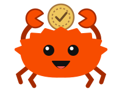

# 04 – Enumy a `match`

[← 03 – Struktury a metody](03-struktury-a-metody.md) · [Obsah](README.md) · [05 – Vlastnictví a výpůjčky →](05-vlastnictvi-a-vypujcky.md) · [GitHub](https://github.com/akabourek/todo-rs)

## Cíl
Stav úkolu už není `bool`, ale enum se třemi stavy (čeká / rozpracovaný / hotový). Umíme hodnotu
rozebrat přes `match`, `matches!` a `if let` a víme, jak Rust bez `null` vyjadřuje „možná hodnota“ – `Option`.

## Nové pojmy a syntaxe

### `enum` – hodnota je právě jedna z vyjmenovaných možností
```rust
#[derive(Debug)]
enum TaskStatus {
    ToDo,          // varianty – PascalCase, oddělené čárkou
    InProgress,
    Done,
}

let s = TaskStatus::Done;
```
- Proč ne dva `bool`y (`done`, `in_progress`)? Šel by vytvořit nesmysl „hotový i rozpracovaný“. Enum
  nesmyslné kombinace vylučuje už v typu.
- `::` čti „z“: `TaskStatus::Done` = varianta `Done` z typu `TaskStatus`. Stejně jako `Task::new`.
- `::` vs `.`: `::` sahá do **typu** (varianta, asociovaná funkce), `.` do **hodnoty** (pole, metoda).

### `match` – rozvětvení podle vzoru
```rust
let symbol = match self.status {
    TaskStatus::ToDo => ' ',
    TaskStatus::InProgress => '~',
    TaskStatus::Done => 'X',
};
```
- Větev: `vzor => výraz,`. Provede se první větev, jejíž vzor sedí.
- `=>` (tlustá šipka) = „pak“. Nezaměnit s `->` = návratový typ funkce.
- `match` je **výraz** (jako `if`) – vrací hodnotu. Uvnitř funkce bez `;` je to rovnou návratová hodnota.
- **Úplnost:** chybí-li větev pro některou variantu, kód se nezkompiluje. Přidáš-li později variantu,
  kompilátor ukáže všechna místa, kde je potřeba ji obsloužit.
- `_ => ...` = „všechno ostatní“. Pohodlné, ale vypíná kontrolu úplnosti – používat s rozmyslem.
- `A | B => ...` = víc vzorů v jedné větvi, `|` = „nebo“. Nezaměnit s `|x|` u closure.

### `char` vs `&str`
```rust
let c: char = 'X';    // jednoduché uvozovky = právě jeden znak
let s: &str = "X";    // dvojité uvozovky = text (libovolná délka)
```
Na rozdíl od Pythonu/JS nejsou jednoduché a dvojité uvozovky zaměnitelné – `let c: char = "X";` je chyba.

### Makro `matches!` – „odpovídá vzoru?“ jako `bool`
```rust
fn is_done(&self) -> bool {
    matches!(self.status, TaskStatus::Done)
}
// totéž jako:
match self.status {
    TaskStatus::Done => true,
    _ => false,
}
```
- `!` = makro (jako `println!`, `vec!`, `dbg!`).
- Uvnitř je schované `_`, takže taky nehlídá úplnost – na „ano/ne“ otázky ideální, na rozvětvení
  s různými výsledky (`symbol()`) patří plný `match`.

### Varianta s daty a `Option<T>`
Varianta enumu může nést hodnotu. Přesně tak je ve standardní knihovně definován `Option`:
```rust
enum Option<T> {
    None,       // nic tu není
    Some(T),    // něco tu je – hodnota typu T
}
```
- `<T>` = **typový parametr** (generikum, víc v lekci 12). `Option<u8>` = „možná `u8`“,
  `Option<&Task>` = „možná půjčený úkol“.
- Rust **nemá `null`**. Kde jiné jazyky vrátí `null`, Rust vrátí `Option` a kompilátor tě donutí
  obsloužit i `None`.
- `Some` a `None` jsou v prelude – píšou se bez `Option::`.
- Uložení hodnoty: `self.priority = Some(priority);`, prázdná: `priority: None`.

### Destrukturování v `match`
```rust
match tasks.get(10) {
    Some(task) => println!("Task found: {}", task.title),
    None => println!("Task not found"),
}
```
`task` ve vzoru `Some(task)` je **nová proměnná** – když vzor sedí, vloží se do ní obsah varianty.
(Stejný princip jako `(index, task)` u `enumerate` v lekci 01.)

### `if let` – zajímá mě jen jedna větev
```rust
if let Some(priority) = task.priority {
    println!("   Priority: {}", priority);
}
```
- Čti: „pokud `task.priority` odpovídá vzoru `Some(priority)`, tak…“.
- `=` zde není přiřazení ani porovnání – odděluje **vzor** (vlevo) od **hodnoty** (vpravo).
- Zkrácený `match`, kde ostatní případy nedělají nic. Může mít `else { ... }`.

### `v[i]` vs `v.get(i)`

| Zápis | Vrací | Index mimo rozsah |
|---|---|---|
| `tasks[10]` | `Task` (prvek) | **panika** – program spadne: `index out of bounds: the len is 3 but the index is 10` |
| `tasks.get(10)` | `Option<&Task>` | `None` – rozhodneš sám, co dál |

`[ ]` použij, když index určitě existuje; `.get()`, když nemusí (např. číslo zadané uživatelem – lekce 06).

## Postup

1. Nad `struct Task` přibyl `enum TaskStatus { ToDo, InProgress, Done }`.
2. V `Task` se `done: bool` nahradilo `status: TaskStatus`; výchozí stav v `new` je `TaskStatus::ToDo`.
3. Metody `complete()` a nová `start()` nastavují `Done` / `InProgress`.
4. Po změně pole se nezkompiloval `filter(|task| task.done)` – pole `done` už neexistuje. Opraveno na
   `task.is_done()` (proto se metody vyplatí: vnitřek typu se změnil, volající kód skoro ne).
5. `symbol()` vrací `char` přes `match`, `is_done()` přes `matches!`.
6. Přibylo pole `priority: Option<u8>` (v `new` = `None`) a metoda `set_priority` (ukládá `Some(...)`).
7. Výpis priority přes `if let`, hledání úkolu podle indexu přes `tasks.get(...)` + `match`.
8. Procvičení: přibyla varianta `Canceled` – kompilátor si vynutil větev v `symbol()` (`'C'`), ale
   `is_done()` s `matches!` mlčel. Výpis priority se zkoušel přes `if let` i `match` (v kódu
   zakomentované) a nakonec ho nahradila metoda `priority_label()` s vnořenými vzory
   `Some(1)`, `Some(2)`, `Some(3)` a `_` pro zbytek (včetně `None`).

Výsledný kód:
```rust
#[derive(Debug)]
enum TaskStatus {
    ToDo,
    InProgress,
    Done,
    Canceled,
}

#[derive(Debug)]
struct Task {
    title: String,
    status: TaskStatus,
    priority: Option<u8>,
}

impl Task {
    fn new(title: &str) -> Self {
        Self {
            title: title.to_string(),
            status: TaskStatus::ToDo,
            priority: None,
        }
    }

    fn rename(&mut self, new_title: &str) {
        self.title = new_title.to_string();
    }

    fn set_priority(&mut self, priority: u8) {
        self.priority = Some(priority);
    }

    fn priority_label(&self) -> &str {
        match self.priority {
            Some(1) => "High",
            Some(2) => "Medium",
            Some(3) => "Low",
            _ => "None",
        }
    }

    fn start(&mut self) {
        self.status = TaskStatus::InProgress;
    }

    fn complete(&mut self) {
        self.status = TaskStatus::Done;
    }

    fn symbol(&self) -> char {
        match self.status {
            TaskStatus::ToDo => ' ',
            TaskStatus::InProgress => '~',
            TaskStatus::Done => 'X',
            TaskStatus::Canceled => 'C',
        }
    }

    fn is_done(&self) -> bool {
        matches!(self.status, TaskStatus::Done)
    }
}

fn main() {
    let mut tasks: Vec<Task> = vec![
        Task::new("Buy groceries"),
        Task::new("Clean the house"),
        Task::new("Finish Rust project"),
    ];

    tasks[1].rename("Clean the entire house");
    tasks[1].complete();
    tasks[2].set_priority(1);
    tasks[2].start();

    //dbg!(&tasks);

    let count_done = tasks.iter().filter(|task| task.is_done()).count();

    tasks.iter().enumerate().for_each(|(index, task)| {
        println!("{}: [{}] {}", index + 1, task.symbol(), task.title);
        // if let Some(priority) = task.priority {
        //     println!("   Priority: {}", priority);
        // }
        // match task.priority {
        //     Some(priority) => println!("   Priority: {}", priority),
        //     None => println!("   No priority set"),
        // };
        println!("   Priority: {}", task.priority_label());
    });

    println!("Done: {}/{}", count_done, tasks.len());

    match tasks.get(10) {
        Some(task) => println!("Task found: {}", task.title),
        None => println!("Task not found"),
    };
}
```
Výstup:
```
1: [ ] Buy groceries
   Priority: None
2: [X] Clean the entire house
   Priority: None
3: [~] Finish Rust project
   Priority: High
Done: 1/3
Task not found
```
Poznámky:
- Kompilátor varuje `variant 'Canceled' is never constructed` – varianta existuje, ale nikde se
  nevytváří (chybí třeba metoda `cancel()`). Je to jen varování (*dead code*), program běží.
- `priority_label()` vrací `&str` a kompilátor nic nenamítá, protože vrací textové literály
  (`"High"`…), které jsou zapsané přímo v programu a platí po celou dobu běhu. Podrobně v lekci 14.
- `;` za posledním `match` není potřeba – `match` tu nic nevrací (obě větve dávají `()`), takže stojí
  samostatně jako příkaz. Neškodí, ale obvykle se nepíše.
- `if let Some(priority) = task.priority` funguje, protože `u8` je malé číslo, které se při vytažení
  prostě **zkopíruje**. Kdyby priorita byla `Option<String>`, kompilátor by protestoval („cannot move out
  of borrowed content“) – proč, to je téma lekce 05 (vlastnictví).

## Tahák



**Ferris radí:** Každá varianta jinak? Plný `match`. Jen ano, nebo ne? `matches!`. Index zadal uživatel? `.get()`.

| Zápis | Význam |
|---|---|
| `enum E { A, B }` | typ s vyjmenovanými variantami |
| `E::A` | varianta `A` typu `E` |
| `match x { A => 1, B => 2 }` | rozvětvení podle vzoru, výraz s hodnotou |
| `=>` | „pak“ ve větvi `match` (≠ `->` návratový typ) |
| `_ => ...` | všechno ostatní (vypíná kontrolu úplnosti) |
| <code>A &#124; B =&gt; ...</code> | víc vzorů v jedné větvi |
| `matches!(x, Vzor)` | `true`/`false`, zda `x` odpovídá vzoru |
| `'X'` / `"X"` | `char` (jeden znak) / `&str` (text) |
| `Option<T>` | `Some(hodnota)` nebo `None` – náhrada za `null` |
| `Some(v) => ...` | vzor, který vytáhne hodnotu do proměnné `v` |
| `if let Some(v) = x { }` | `match` jen pro jednu větev |
| `v[i]` / `v.get(i)` | prvek (panika mimo rozsah) / `Option<&T>` |

## Procvičení
1. Přidej do `TaskStatus` variantu `Cancelled` a nech se kompilátorem dovést ke všem místům, kde chybí.
   Které místo tě neupozorní a proč? (nápověda: `matches!`)
2. Přepiš výpis priority z `if let` na `match` s větví `None`, která vypíše `   Priority: -`.
3. Přidej metodu `fn priority_label(&self) -> &str`, která podle priority vrátí `"high"` (1),
   `"medium"` (2), `"low"` (cokoliv jiného) a `"none"` (`None`). Nápověda: vzory jde vnořit –
   `Some(1) => ...`, `Some(_) => ...`.

## Odkazy
- [Infografika: Která přihrádka?](infografika/04-enumy-infografika.html) – enum jako žeton, `match` jako třídička, `Option` jako krabice + hřiště, kde se dají vypínat větve (otevřít v prohlížeči)
- [Rust Book 6 – Enums and Pattern Matching](https://doc.rust-lang.org/book/ch06-00-enums.html)
- [Rust Book 6.2 – The match Control Flow Construct](https://doc.rust-lang.org/book/ch06-02-match.html)
- [Rust Book 6.3 – Concise Control Flow with if let](https://doc.rust-lang.org/book/ch06-03-if-let.html)
- [std::option::Option](https://doc.rust-lang.org/std/option/enum.Option.html)
- [Rust Book 8.1 – Reading Elements of Vectors (`[]` vs `get`)](https://doc.rust-lang.org/book/ch08-01-vectors.html#reading-elements-of-vectors)

---

[← 03 – Struktury a metody](03-struktury-a-metody.md) · [Obsah](README.md) · [05 – Vlastnictví a výpůjčky →](05-vlastnictvi-a-vypujcky.md) · [GitHub](https://github.com/akabourek/todo-rs)
