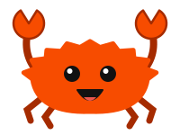

# Journal – Rust od nuly přes ToDo list

<a href="kviz/kviz.html" title="Kvíz: Ferrisova zkouška"></a>

[Zdrojový kód na GitHubu](https://github.com/akabourek/todo-rs)

Každá lekce = jeden krok aplikace + jeden okruh Rustu. Kód ke každé lekci je v gitu pod tagem `lekce-NN`:

```bash
git tag                    # seznam lekcí
git checkout lekce-01      # stav kódu po lekci 01
git checkout main          # zpět na aktuální stav
git diff lekce-01 lekce-02 # co přibylo mezi lekcemi
```

## Obsah

- [Kvíz: Ferrisova zkouška](kviz/kviz.html) – opakování hotových lekcí: otázky s vysvětlením, výběr lekcí, rychlá varianta a zopakování chybných (otevřít v prohlížeči)

### Část I – Základy (konzole)
- [00 – Příprava prostředí](00-priprava.md)
  - [Infografika: Dílna na Rust](infografika/00-priprava-infografika.html) – rustup, rustc, cargo a git jako dílna, co udělá `cargo init`/`check`/`build`/`run` + hřiště s terminálem a stromem souborů (otevřít v prohlížeči)
- [01 – První program](01-prvni-program.md) – proměnné, `Vec`, `for`, makra, closure `|x|`
  - [Infografika: Štítky a sklenice](infografika/01-prvni-program-infografika.html) – proměnné jako štítky na sklenicích, pole jako plato vs `Vec` jako regál, `for` jako pás, closure jako strojek + hřiště s `push`/`mut` a krokováním `for` (otevřít v prohlížeči)
- [02 – Debugování ve VS Code](02-debugovani.md) – CodeLLDB, breakpointy, krokování, `dbg!`
  - [Infografika: Pauza na dálkovém](infografika/02-debugovani-infografika.html) – debugger jako dálkové ovládání, breakpoint, krokování F10/F11/⇧F11, panely, `dbg!` + hřiště se simulovaným debuggerem nad `main.rs` z lekce 02 (otevřít v prohlížeči)
- [03 – Struktury a metody](03-struktury-a-metody.md) – `struct`, `impl`, `&self`, `String` vs `&str`, `if` jako výraz
  - [Infografika: Kartotéka úkolů](infografika/03-struktury-infografika.html) – `struct` jako šablona karty, `impl` jako razítko a tlačítka (lupa `&self` / tužka `&mut self`), `String` vs `&str` + hřiště s metodami na kartách (otevřít v prohlížeči)
- [04 – Enumy a `match`](04-enumy-a-match.md) – `enum`, `match`, `matches!`, `Option`, `if let`, `get` vs `[]`
  - [Infografika: Která přihrádka?](infografika/04-enumy-infografika.html) – třídička na enumy, krabice `Option` + hřiště s větvemi `match` (otevřít v prohlížeči)
- [05 – Vlastnictví a výpůjčky](05-vlastnictvi-a-vypujcky.md) – move, `Copy`/`clone`, `&`/`&mut`, borrow checker, slice `&[T]`
  - [Infografika: Kdo drží krabici?](infografika/05-vlastnictvi-infografika.html) – vlastnictví na krabicích + hřiště na borrow checker (otevřít v prohlížeči)
- [06 – Vstup od uživatele](06-vstup-od-uzivatele.md) – stdin, `loop`, EOF, `split_once`, `parse::<usize>()`, `get_mut`, let chains
  - [Infografika: Cesta příkazu](infografika/06-vstup-infografika.html) – cesta textu programem, řetězení podmínek jako řada branek + hřiště (otevřít v prohlížeči)
- [07 – Chyby](07-chyby.md) – `Result`, `return`, operátor `?`, `ok_or`/`map_err`, vlastní `enum TaskError`, `impl Display`
  - [Infografika: Červená obálka](infografika/07-chyby-infografika.html) – obálky `Ok`/`Err` putují patry funkcí, `?` jako potrubní pošta + hřiště s cestou příkazu a „rozbij kód“ (otevřít v prohlížeči)
- [08 – Moduly](08-moduly.md) – `mod`, `crate::`, `use`, `pub`, soukromá pole a metody místo nich
  - [Infografika: Úřad s přepážkami](infografika/08-moduly-infografika.html) – moduly jako kanceláře, `pub` jako přepážka, `use` jako rychlá volba + hřiště s cestou příkazu, „kdo na co dosáhne“ a „rozbij kód“ (otevřít v prohlížeči)

Celá plánovaná osnova je v [AGENTS.md](../AGENTS.md#osnova-stav--hotovo--čeká).

---

Ferris je neoficiální maskot Rustu (původní návrh Karen Rustad Tölva, [rustacean.net](https://rustacean.net/)), tady překreslený zjednodušeně.
